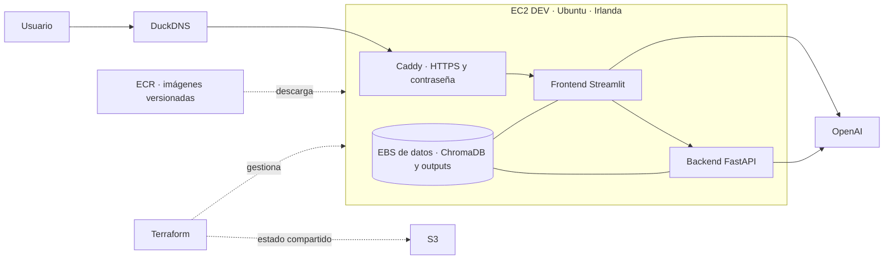

# Sistema RAG — Reformas de Vehículos + Generador de Proyectos Técnicos

> Manual de Reformas DGT (Revisión 7.2 — Secciones I, II, III y IV) · Reglamento (UE) 2018/858
> RAG de consulta (220 fichas CR) + Generación automática de proyectos técnicos Vía A

---

## Índice

1. [Visión general](#1-visión-general)
2. [Arquitectura del sistema](#2-arquitectura-del-sistema)
3. [Módulo RAG — Parsers e indexación](#3-módulo-rag--parsers-e-indexación)
4. [Módulo Generador de Proyectos Técnicos](#4-módulo-generador-de-proyectos-técnicos)
5. [Flujo completo de generación](#5-flujo-completo-de-generación)
6. [API REST (FastAPI)](#6-api-rest-fastapi)
7. [Frontend Streamlit](#7-frontend-streamlit)
8. [Generación del documento Word](#8-generación-del-documento-word)
9. [Puesta en marcha](#9-puesta-en-marcha)
10. [Configuración de modelos](#10-configuración-de-modelos)
    - [10.5 Bedrock: prueba local y estado de la migración](#105-bedrock-prueba-local-y-estado-de-la-migración)
11. [Tests](#11-tests)
12. [Estructura del proyecto](#12-estructura-del-proyecto)
13. [Pendiente / Roadmap](#13-pendiente--roadmap)
14. [Despliegue en AWS](#14-despliegue-en-aws)
    - [14.1 Cuentas, roles y configuración inicial de acceso](#141-cuentas-roles-y-configuración-inicial-de-acceso)
    - [14.2 Despliegue manual del piloto en EC2](#142-despliegue-manual-del-piloto-en-ec2)
    - [14.3 Preparación del repositorio: Docker y entornos](#143-preparación-del-repositorio-docker-y-entornos)
    - [14.4 Terraform: estado compartido e infraestructura DEV](#144-terraform-estado-compartido-e-infraestructura-dev)
    - [14.5 DEV publicado y operación](#145-dev-publicado-y-operación)

---

## 1. Visión general

El sistema tiene dos módulos principales:

### 1.1 Chatbot RAG de consulta (`/frontend`, `/backend`)

Responde preguntas sobre el Manual de Reformas DGT (las cuatro secciones): qué documentación exige una reforma, qué categorías de vehículo aplican, qué Actos Reglamentarios hay que cumplir, qué vía de tramitación corresponde, etc.

- **Sección I** — Vehículos M, N, O (turismos, furgonetas, camiones, remolques) — 76 fichas
- **Sección II** — Vehículos L, Quads y UTV (motos, ciclomotores, triciclos) — 54 fichas
- **Sección III** — Vehículos agrícolas (tractores, maquinaria automotriz) — 45 fichas
- **Sección IV** — Vehículos de obras y/o servicios — 45 fichas

### 1.2 Generador de Proyectos Técnicos Vía A (`/proyecto_tecnico`)

Genera automáticamente el proyecto técnico completo para una reforma de vehículo (Vía A) a partir de los datos introducidos por el ingeniero. El sistema:

1. Identifica los CRs aplicables consultando la ChromaDB
2. Filtra los Actos Reglamentarios por categoría del vehículo
3. Redacta todas las secciones del proyecto técnico usando LLMs
4. Permite al ingeniero revisar, aprobar o solicitar reescritura de cada sección
5. Genera el documento Word final maquetado (portada, índice, tablas, cabecera/pie)

---

## 2. Arquitectura del sistema

```
┌─────────────────────────────────────────────────────────┐
│                    Frontend Streamlit                    │
│         proyecto_tecnico/frontend/proyecto_tecnico_app.py│
└──────────────────────────┬──────────────────────────────┘
                           │ llama directamente al grafo
┌──────────────────────────▼──────────────────────────────┐
│              LangGraph (proyecto_tecnico/graph.py)        │
│                                                          │
│  identificador_cr ──► [redactor_memoria               ]  │
│                        [redactor_pliego    ] (paralelo)  │
│                        [redactor_conclusiones          ]  │
│                              │                           │
│                        revision_humana ◄── interrupt     │
│                              │                           │
│                         ensamblador                      │
│                              │                           │
│                          .docx                           │
└──────────────────────────┬──────────────────────────────┘
                           │ filtro seccion=I
┌──────────────────────────▼──────────────────────────────┐
│              ChromaDB (scripts_index/chroma_db/)         │
│  fichas_cr · 220 fichas (Sec. I: 76 · II: 54 · III+IV: 90)│
│  + graph.json · Grafo KAG · 220 nodos · 362 edges       │
└─────────────────────────────────────────────────────────┘
```

**Modelos usados (configurables vía `.env` — ver [sección 10](#10-configuración-de-modelos)):**

| Agente | Variable `.env` | Default | Rol |
|---|---|---|---|
| Identificador CR | `MODELO_RAZONAMIENTO` | `gpt-4o` | Análisis semántico + filtrado de ARs |
| Validador CRs | `MODELO_RAZONAMIENTO` | `gpt-4o` | Validación de vías + CRs adicionales |
| Redactor Memoria | `MODELO_REDACCION` | `gpt-4o-mini` | Secciones 0, 1.1, 1.2, 1.3.1, 1.4 |
| Redactor Pliego | `MODELO_REDACCION` | `gpt-4o-mini` | Secciones 3.1, 3.2, 3.3, 3.4 |
| Redactor Conclusiones | `MODELO_REDACCION` | `gpt-4o-mini` | Sección 8 |
| Ensamblador | — | Node.js (`docx`) | Documento Word final |
| Embeddings | `MODELO_EMBEDDING` | `text-embedding-3-small` | Indexación y búsqueda semántica |

---

## 3. Módulo RAG — Parsers e indexación

### 3.1 Documentos parseados

| Documento | Fuente | Output JSON | Chunks / Fichas |
|---|---|---|---|
| Fichas CR — Sección I (M, N, O) | Manual Rev. 7.2 págs. 18–212 | `fichas_cr_seccion1_v3.json` | 76 fichas |
| Fichas CR — Secciones II, III, IV | Manual Rev. 7.2 págs. 218–828 | `fichas_cr_secciones_ii_iii_iv.json` | 144 fichas |
| Preámbulo | Manual Rev. 7.2 págs. 3–12 | `preambulo_seccion1.json` | 9 chunks |
| Reglamento (UE) 2018/858 | DOUE L 151, 14.6.2018 | `reglamento_ue_2018_858.json` | 8 chunks |

### 3.2 Parsers

- **`scripts_parser/parser_cr_seccion1.py`** — Extrae las 76 fichas de Sección I (M, N, O) con `pdfplumber`. Arquitectura híbrida: `extract_tables()` para tablas de campo de aplicación y ARs (12 columnas), `extract_text()` para campos de texto libre.
- **`scripts_parser/parser_cr_secciones_ii_iii_iv.py`** — Extrae las 144 fichas de Secciones II (11 cols: Quad/L1e–L7e), III y IV (15 cols: T1–MAR). Reutiliza la misma lógica de texto; la extracción de tablas de ARs es flexible por número de columnas.
- **`scripts_parser/parser_preambulo_updated.py`** — 9 chunks semánticos del nuevo PDF. El chunk `interpretacion_ars` se inyecta en el texto de embedding de cada ficha CR.
- **`scripts_parser/parser_reglamento_ue.py`** — Artículos 3 y 4 + Anexo I del Reglamento (UE) 2018/858. Normaliza subíndices (M₁→M1) extraídos en líneas separadas.

### 3.3 Vías de tramitación

| Vía | Condición | Documentación exigible |
|---|---|---|
| **A** | Proyecto Técnico = SI | PT + CFO + IC + CT |
| **B** | PT = NO, IC = SI | IC + CT |
| **C** | Solo CT | Certificado de Taller |
| **D** | Solo doc. adicional | Documentación específica |

### 3.4 Indexación — ChromaDB

**Embeddings:** `text-embedding-3-small` (OpenAI). Mismo modelo en indexación y consulta.

| Colección | Docs / Chunks | Cuándo se consulta | Metadatos clave |
|---|---|---|---|
| `fichas_cr` | 220 fichas | Siempre | `via_tramitacion`, `seccion`, `cr`, `categorias` |
| `preambulo` | 9 chunks | Si menciona documentación / tramitación | `apartado`, `retrieval_condicional` |
| `reglamento_ue` | 8 chunks | Si menciona categorías de vehículo | `articulo`, `categorias` |
| `directivas_ar` | 3 442 chunks (103 normativas) | Si la query contiene una referencia AR (`71/320/CEE`, `R(UE)...`) o palabras como "directiva", "qué establece", "derogada" | `referencia`, `celex`, `derogada`, `secciones` |

IDs de fichas_cr: `cr_{seccion}_{cr}` (ej. `cr_I_5_1`) para evitar colisiones entre secciones. El generador siempre filtra `seccion="I"`.

Las directivas derogadas se recuperan normalmente pero el LLM está instruido para advertirlo de forma explícita antes de dar cualquier información.

El texto de embedding de cada ficha CR incluye: descripción, categorías, vía, documentación, keywords del cliente e **interpretación de ARs inyectada**.

### 3.5 Enriquecimiento de keywords

```bash
# El cliente añade términos reales de taller en:
scripts_enrich/keywords_reformas.csv

# Aplicar enriquecimiento:
python scripts_enrich/enriquecimiento.py
python scripts_index/indexado.py --reset
```

---

## 4. Módulo Generador de Proyectos Técnicos

### 4.1 Secciones generadas automáticamente

| Sección | ID interno | Agente |
|---|---|---|
| 0. Peticionario | `peticionario` | Redactor Memoria |
| 1.1 Objeto | `objeto` | Redactor Memoria |
| 1.2 Antecedentes | `antecedentes` | Redactor Memoria |
| 1.3.1 Identificación del vehículo | `identificacion_vehiculo` | Redactor Memoria |
| 1.4 Descripción de la reforma | `descripcion_reforma` | Redactor Memoria |
| 3.1 Calidad de materiales | `calidad_materiales` | Redactor Pliego |
| 3.2 Normas de ejecución | `normas_ejecucion` | Redactor Pliego |
| 3.3 Certificados y autorizaciones | `certificados` | Redactor Pliego |
| 3.4 Taller ejecutor | `taller_ejecutor` | Redactor Pliego |
| 8. Conclusiones | `conclusiones` | Redactor Conclusiones |

### 4.2 Secciones completadas por el ingeniero (con uploader)

| Sección | Marcador en el Word |
|---|---|
| 1.3.2 Características antes de la reforma | Caja de texto editable en revisión; si se deja vacía → `[COMPLETAR]` en rojo |
| 1.3.3 Características después de la reforma | Caja de texto editable en revisión; si se deja vacía → `[COMPLETAR]` en rojo |
| 2. Cálculos justificativos | Fichero adjunto o `[COMPLETAR]` |
| 4. Presupuesto | Fichero adjunto o `[COMPLETAR]` |
| 5. Planos | Fichero adjunto o `[COMPLETAR]` |
| 6. Reportaje fotográfico | Imagen incrustada o `[COMPLETAR]` |
| 7. Documentación del vehículo | Fichero adjunto o `[COMPLETAR]` |

### 4.3 Agentes

#### `identificador_cr.py` (Agente 1 — `MODELO_RAZONAMIENTO`)

- Si el ingeniero indica CRs → recuperación exacta por metadato `cr` en ChromaDB (sin búsqueda semántica)
- Si no indica CRs → búsqueda semántica en ChromaDB sobre la descripción de la reforma
- Filtra los ARs de cada ficha CR por la categoría del vehículo
- Detecta CRs adicionales mencionados en `informacion_adicional`
- Usa **tool calling** (`with_structured_output`) para obtener la respuesta del LLM como objeto Pydantic validado, sin parsing manual de JSON

#### `redactor_memoria.py` (Agente 2 — `MODELO_REDACCION`)

Genera las secciones 0, 1.1, 1.2, 1.3.1 y 1.4 en paralelo. Los prompts instruyen al LLM a:
- **1.2 Antecedentes**: solo texto en párrafos (sin tablas markdown). Las tablas de CRs y ARs las añade el ensamblador.
- **1.3.1 Identificación del vehículo**: solo 1-2 frases introductorias. La ficha técnica la añade el ensamblador como tabla Word.

#### `redactor_pliego.py` (Agente 3 — `MODELO_REDACCION`)

Genera las secciones 3.1, 3.2, 3.3 y 3.4 del Pliego de Condiciones.

#### `redactor_conclusiones.py` (Agente 4 — `MODELO_REDACCION`)

Genera la sección 8 (Conclusiones) con declaración de viabilidad técnica, CRs aplicables, ARs a verificar en ITV y bloque de firma del ingeniero.

#### `ensamblador.py` (Agente 5 — Node.js)

Genera el `.docx` final. Funcionalidades especiales:
- **Sección 1.2**: añade tabla Word de CRs + tabla Word de ARs tras el texto introductorio
- **Sección 1.3.1**: añade tabla Word con todos los datos del vehículo (Marca, Modelo, VIN, Matrícula, Categoría, Fecha de matriculación, Color, Kilometraje)
- **Secciones del ingeniero**: incrusta imágenes (JPG/PNG) directamente en el documento; para PDFs/DWG muestra indicador `📎 Adjunto: nombre.pdf`

### 4.4 Validador de CRs (`validador_crs.py`)

Endpoint previo a la generación que:
1. Recupera cada CR indicado por búsqueda exacta en ChromaDB
2. Clasifica en Vía A (incluir) y otras vías (excluir)
3. Analiza `informacion_adicional` con el LLM para detectar CRs adicionales vía A
4. Si ningún CR es Vía A → devuelve `valido=False` bloqueando la generación

---

## 5. Flujo completo de generación

```
Ingeniero rellena formulario (datos vehículo, reforma, taller, ingeniero)
        │
        ▼
[Opcional] Validar CRs → resumen de CRs incluidos/excluidos/adicionales
        │
        ▼
Generar proyecto técnico
        │
        ▼
Agente 1: Identificador CR
  - Recupera fichas CR de ChromaDB (exacto o semántico)
  - Filtra ARs por categoría del vehículo
        │
        ▼
Agentes 2, 3, 4 en paralelo:
  - Redactor Memoria   → secciones 0, 1.1, 1.2, 1.3.1, 1.4
  - Redactor Pliego    → secciones 3.1, 3.2, 3.3, 3.4
  - Redactor Conclusiones → sección 8
        │
        ▼
interrupt_before("revision_humana")
  → Frontend muestra secciones al ingeniero (tabs)
  → El ingeniero puede: Aprobar | Solicitar reescritura (con motivo)
        │
        ├─ Si hay reescrituras → agentes correspondientes regeneran
        │  (solo las secciones marcadas, con contexto del motivo)
        │
        ▼
Ingeniero sube ficheros (cálculos, presupuesto, planos, fotos, documentación)
        │
        ▼
Generar documento Word
  → Ensamblador Node.js construye el .docx
  → Portada + Índice automático + Secciones + Tablas + Imágenes
        │
        ▼
Descarga del .docx
```

### 5.1 Lógica de reescritura

Cuando el ingeniero solicita reescritura de una sección:
- El grafo reanuda desde `revision_humana` vía `update_state(as_node="revision_humana")`
- `enrutar_regeneracion()` determina qué agente debe regenerar según la sección:
  - Secciones 0, 1.x → `redactor_memoria`
  - Secciones 3.x → `redactor_pliego`
  - Sección 8 → `redactor_conclusiones`
- El agente recibe el motivo de la reescritura y la versión anterior como contexto
- Solo se regeneran las secciones marcadas, el resto se conserva

---

## 6. API REST (FastAPI)

Servidor en `http://localhost:8000`. Router montado en `/proyecto-tecnico`.

| Método | Endpoint | Descripción |
|---|---|---|
| `POST` | `/proyecto-tecnico/validar-crs` | Valida CRs antes de generar |
| `POST` | `/proyecto-tecnico/generar` | Inicia generación del proyecto |
| `POST` | `/proyecto-tecnico/{id}/revisar` | Registra aprobación o reescritura |
| `POST` | `/proyecto-tecnico/{id}/adjunto` | Sube fichero a una sección |
| `POST` | `/proyecto-tecnico/{id}/documento` | Genera el Word final |
| `GET`  | `/proyecto-tecnico/{id}/descargar` | Descarga el .docx generado |

```bash
# Arrancar backend
uvicorn backend.main:app --reload --port 8000
```

---

## 7. Frontend Streamlit

Interfaz de 4 pasos en `proyecto_tecnico/frontend/proyecto_tecnico_app.py`.

```bash
streamlit run proyecto_tecnico/frontend/proyecto_tecnico_app.py --server.port 8502
```

**Paso 1 — Formulario de entrada**
- Datos del vehículo (marca, modelo, VIN, matrícula, categoría, color, km)
- Datos del ingeniero (nombre, titulación, colegio, nº colegiado)
- Datos del taller ejecutor
- Descripción libre de la reforma
- CRs identificados (opcional; si se indican, se validan antes de generar)
- Componentes instalados (con marca, modelo, referencia, nº homologación)

**Paso 2 — Generación**
- Barra de progreso con estado en tiempo real
- El grafo LangGraph se ejecuta directamente (sin HTTP)

**Paso 3 — Revisión**
- Tab por sección con el texto generado
- Botones: Aprobar / Solicitar reescritura (con campo de motivo)
- Uploader de ficheros para secciones del ingeniero (2, 4, 5, 6, 7)
- Botón "Aprobar todas las pendientes" para agilizar
- Botón "Regenerar secciones marcadas" lanza solo los agentes necesarios

**Paso 4 — Descarga**
- Descarga del `.docx` generado

---

## 8. Generación del documento Word

El ensamblador escribe un script Node.js en `/tmp` y lo ejecuta con `subprocess`. La librería `docx` (npm) genera el `.docx`.

### 8.1 Estructura del documento

1. **Portada** (sin cabecera/pie): título, datos del vehículo, CRs, ingeniero, expediente, fecha
2. **Índice automático** (TOC con hipervínculos)
3. **Secciones del proyecto** con cabecera (vehículo + bastidor) y pie (ingeniero + nº página)

### 8.2 Tablas generadas automáticamente

| Tabla | Sección | Contenido |
|---|---|---|
| Tabla de CRs | 1.2 Antecedentes | Código · Denominación · Vía |
| Tabla de ARs | 1.2 Antecedentes | Sistema · Referencia · Nivel · Descripción |
| Ficha técnica del vehículo | 1.3.1 Identificación | Marca, Modelo, VIN, Matrícula, Categoría, Fecha, Color, Km |

### 8.3 Adjuntos incrustados

- **Imágenes** (JPG, JPEG, PNG): se incrustan inline en el documento Word con `ImageRun` (500×350 px)
- **Otros formatos** (PDF, DWG, XLSX): se muestra indicador `📎 Adjunto: nombre_fichero`
- **Sin adjunto**: marcador `[COMPLETAR POR EL INGENIERO]` en rojo con borde discontinuo

### 8.4 Payload al script JS

```json
{
  "proyecto_id": "...",
  "metadata": {
    "vehiculo": "VW Golf",
    "bastidor": "WVWZZZ...",
    "matricula": "1234 ABC",
    "categoria": "M1",
    "fecha_matriculacion": "15/03/2018",
    "color": "Blanco",
    "kilometraje": "85.000 km",
    "ingeniero": "Juan García",
    ...
  },
  "crs": [{"codigo": "2.1", "denominacion": "...", "via": "A"}],
  "ars": [{"sistema": "...", "referencia": "...", "nivel": "(1)", "descripcion": "..."}],
  "secciones": [{"id": "peticionario", "titulo": "0. Peticionario", "contenido": "..."}],
  "adjuntos": {
    "calculos": {"nombre": "calculos.pdf", "path": "/tmp/xxx.pdf", "es_imagen": false},
    "fotografias": {"nombre": "coche.jpg", "path": "/tmp/yyy.jpg", "es_imagen": true}
  }
}
```

---

## 9. Puesta en marcha

### 9.0 Prerrequisito: variables de entorno

Copia el fichero de ejemplo y rellena tu clave de OpenAI:

```bash
cp .env.example .env
```

Edita `.env` y añade al menos:

```
OPENAI_API_KEY=sk-...
```

Las variables de LangSmith son opcionales. Si no las necesitas, deja `LANGCHAIN_TRACING_V2=false` y el resto vacío.

Los modelos tienen defaults seguros y **no es necesario definirlos** para que el sistema funcione. Solo añádelos si quieres cambiar el modelo por defecto (ver [sección 10](#10-configuración-de-modelos)).

---

### 9.1 Preparación inicial de la base vectorial (una sola vez)

La ChromaDB debe indexarse antes de arrancar el sistema, independientemente de si se usa Docker o entorno local.

```bash
# 1. Parsear fichas CR de todas las secciones
python scripts_parser/parser_cr_seccion1.py              # Sección I — 76 fichas
python scripts_parser/parser_cr_secciones_ii_iii_iv.py  # Secciones II, III y IV — 144 fichas
python scripts_parser/parser_preambulo_updated.py        # Preámbulo (Rev. 7.2)
python scripts_parser/parser_reglamento_ue.py            # Reglamento (UE) 2018/858

# 2. Enriquecer con keywords del cliente (opcional)
python scripts_enrich/enriquecimiento.py
python scripts_enrich/enriquecimiento.py \
  --fichas json/fichas_cr_secciones_ii_iii_iv.json \
  --output json/fichas_cr_secciones_ii_iii_iv.json

# 3. Indexar en ChromaDB — 220 fichas en total
python scripts_index/indexado.py --reset

# 4. Construir el grafo KAG — genera graph.json y json/normativas_ar.json
python scripts_graph/build_graph.py

# 5. Descargar normativas AR desde EUR-Lex e indexarlas (opcional pero recomendado)
python scripts_parser/parser_directivas_ar.py        # descarga 103 normativas (~6 min)
python scripts_index/indexado.py --solo directivas   # indexa 3 442 chunks en ChromaDB
```

Verificación:

```bash
python scripts_index/inspect_chroma.py               # resumen de colecciones
python scripts_index/inspect_chroma.py --col fichas_cr  # detalle colección
```

---

### 9.2 Opción A — Docker (recomendado para ejecutar en cualquier máquina)

**Requisitos:** Docker Desktop instalado y corriendo.

```bash
# 1. Asegúrate de tener el .env y la chroma_db indexada (ver 9.0 y 9.1)

# 2. Construir y arrancar los contenedores
docker compose up --build

# Para arrancar en segundo plano
docker compose up --build -d

# Para parar
docker compose down
```

Una vez arrancado:
- Frontend: [http://localhost:8501](http://localhost:8501)
- Backend (API): [http://localhost:8000](http://localhost:8000)
- Documentación API: [http://localhost:8000/docs](http://localhost:8000/docs)

Los documentos Word generados se guardan en `outputs/proyectos/` en el host.

---

### 9.3 Opción B — Entorno virtual local (desarrollo)

**Requisitos:** Python 3.11 y Node.js 24 LTS (incluidos en la imagen Docker).

```bash
# 1. Crear el entorno virtual
python3.11 -m venv hm_venv

# 2. Activarlo
source hm_venv/bin/activate          # macOS / Linux
# hm_venv\Scripts\activate           # Windows

# 3. Instalar dependencias Python
pip install -r requirements.txt

# 4. Instalar dependencia Node.js para el ensamblador
npm install

# 5. Asegúrate de tener el .env y la chroma_db indexada (ver 9.0 y 9.1)

# 6. Arrancar
# Terminal 1 — Backend FastAPI
uvicorn backend.main:app --reload --port 8000

# Terminal 2 — Frontend (hub con chatbot + generador)
streamlit run frontend/app.py --server.port 8501
```

---

### 9.4 Actualización de keywords (recurrente)

```bash
# Añadir filas en scripts_enrich/keywords_reformas.csv, luego:
python scripts_enrich/enriquecimiento.py
python scripts_enrich/enriquecimiento.py \
  --fichas json/fichas_cr_secciones_ii_iii_iv.json \
  --output json/fichas_cr_secciones_ii_iii_iv.json
python scripts_index/indexado.py --reset
```

---

## 10. Configuración de modelos

La selección de modelos se lee y valida en `proyecto_tecnico/model_config.py`,
compartida por `proyecto_tecnico/config.py` (generador) y `backend/rag/config.py`
(RAG). Las variables de entorno del proceso tienen prioridad sobre `.env`.

**Migración por fases:** chatbot, auxiliares y agentes utilizan el adaptador común.
La configuración selecciona el cliente de texto OpenAI o Bedrock de cada grupo.
La integración cuenta con pruebas automatizadas con clientes/transportes simulados
y pruebas reales en Docker local con Sonnet 4.6 y Haiku 4.5. Se ha comprobado el
chatbot y la generación del Word, con llamadas visibles en CloudWatch. Quedan
pendientes el despliegue de Bedrock en EC2 y la validación de la familia 5.
Los embeddings siguen en OpenAI.

### 10.1 Variables disponibles

| Variable | Default | Afecta a |
|---|---|---|
| `PROVEEDOR_RAZONAMIENTO` | `openai` | Proveedor de razonamiento y validación; admite `openai` o `bedrock` |
| `MODELO_RAZONAMIENTO` | `gpt-4o` | Identificador CR, condiciones KAG y Validador CR |
| `PROVEEDOR_REDACCION` | `openai` | Proveedor de chatbot, redactores y auxiliares; admite `openai` o `bedrock` |
| `MODELO_REDACCION` | `gpt-4o-mini` | Redactor Memoria, Pliego, Conclusiones, RAG chain |
| `AWS_REGION` | `eu-west-1` | Región prevista para Bedrock; se usa `AWS_DEFAULT_REGION` si no se define |
| `MODELO_EMBEDDING` | `text-embedding-3-small` | Embeddings de consulta; la indexación actual utiliza ese modelo explícitamente |

Los proveedores se normalizan a minúsculas; un valor desconocido produce un error
de configuración. Con `bedrock` es obligatorio indicar explícitamente el modelo o
perfil de inferencia: no se hereda un modelo predeterminado de OpenAI. La validación
no consulta AWS ni comprueba aún disponibilidad o capacidades del modelo.
`OPENAI_API_KEY` sigue siendo necesaria porque los embeddings permanecen en OpenAI,
incluso cuando se complete la migración de los modelos de texto.

No quedan nombres de modelo de texto fijados en los agentes: la reformulación
de consultas utiliza redacción y el Validador CR utiliza razonamiento. Este último
pasa de su antiguo `gpt-4o-mini` fijo al modelo de razonamiento configurado, por lo
que puede cambiar su consumo y comportamiento incluso manteniendo OpenAI.
No hay variable de validación separada ni fallback automático entre proveedores.

### 10.2 Cómo actualizar a un nuevo modelo

```bash
# En .env, añadir o modificar:
PROVEEDOR_RAZONAMIENTO=openai
MODELO_RAZONAMIENTO=gpt-4.1
PROVEEDOR_REDACCION=openai
MODELO_REDACCION=gpt-4o-mini-2025-04-14
```

Reiniciar los procesos backend y frontend para recargar la configuración. En Docker,
recrear los contenedores con `compose up -d` (o `--force-recreate`), usando el mismo
archivo de entorno y los Compose del despliegue; un simple `restart` no carga nuevas
variables de entorno. Con imágenes publicadas, conservar `--no-build --pull never`.

> **⚠️ Cambio de `MODELO_EMBEDDING`:** si se cambia el modelo de embeddings hay que re-indexar la ChromaDB completa, ya que los vectores almacenados son incompatibles con un modelo diferente:
> ```bash
> python scripts_index/indexado.py --reset
> ```

### 10.3 Salidas estructuradas (tool calling)

El `identificador_cr.py` usa `get_reasoning_model(...).with_structured_output()`
para obtener un objeto Pydantic validado. El esquema es `_RespuestaCRs`:

```python
class _RespuestaCRs(BaseModel):
    crs_identificados: list[_CRIdentificado]
    crs_adicionales_detectados: list[_CRAdicional]
```

La salida se valida con Pydantic y reduce el parseo manual. Todavía es necesario
gestionar errores de formato o generación; la compatibilidad de estos esquemas con
Bedrock debe comprobarse también con llamadas reales a los modelos elegidos; se
ha validado en local con Sonnet 4.6, incluida una prueba Pydantic independiente.
KAG utiliza igualmente un esquema Pydantic. El Validador CR conserva su análisis
JSON de información adicional: moverlo al grupo de razonamiento no reescribe su lógica.

### 10.4 Adaptador común de modelos

`proyecto_tecnico/model_adapter.py` expone la interfaz utilizada por los agentes:

| Operación | Resultado |
|---|---|
| `get_reasoning_model()` | Selecciona el proveedor/modelo de razonamiento y validación |
| `get_writing_model()` | Selecciona el proveedor/modelo de redacción y chatbot |
| `invoke(...)` / `ainvoke(...)` | Mensaje `AIMessage` con `.content` de texto normalizado |
| `with_structured_output(Esquema)` | Adaptador síncrono/asíncrono que devuelve el objeto Pydantic validado |

Las fábricas aceptan `temperature` y `max_tokens`; `temperature=None` omite ese
parámetro para modelos que no lo admitan. Las diferencias adicionales de capacidades
deben verificarse al seleccionar cada modelo. El cliente OpenAI es `ChatOpenAI` y
el de AWS es `ChatBedrockConverse`, mediante `langchain-aws==0.2.35`, compatible con
el stack LangChain 0.3 actual. Bedrock necesita un modelo/perfil compatible con
Converse, no cualquier modelo del catálogo. No soporta en esta fase streaming,
embeddings ni todas las funcionalidades de cada proveedor.

Ejemplo de uso:

```python
from proyecto_tecnico.model_adapter import get_reasoning_model, get_writing_model

# El punto de entrada debe haber cargado la configuración del entorno.
redactor = get_writing_model(max_tokens=4096)
mensaje = redactor.invoke("Redacta una explicación utilizando el contexto aportado.")
texto = mensaje.content

# Esquema debe ser una clase Pydantic BaseModel del proyecto.
# resultado = await get_reasoning_model().with_structured_output(Esquema).ainvoke(mensajes)
```

El adaptador conserva metadatos de respuesta y consumo cuando el cliente los
proporciona. En Bedrock extrae los bloques de texto, sin añadir bloques de
razonamiento al contenido mostrado. Una respuesta sin texto genera error explícito.
La salida estructurada usa herramientas y validación Pydantic; no supone que el
modelo soporte de antemano cualquier esquema. Los fallos de invocación se exponen
como `ModelAdapterError`, con la excepción original como causa, sin fallback a
otro proveedor ni reintentos adicionales propios del adaptador.

Los clientes se crean al solicitar el modelo, no al importar el módulo. OpenAI
utiliza sus credenciales habituales; Bedrock usa la cadena de credenciales del SDK
AWS, sin claves o perfil fijados en código. El acceso con credenciales dentro de los
contenedores y los permisos de invocación están comprobados en local; para EC2 sigue
pendiente preparar el acceso mediante el rol de la instancia. El adaptador no carga `.env`
por su cuenta ni modifica infraestructura. La selección por sí sola tampoco verifica
remotamente el acceso al modelo.

Los redactores y el identificador crean sus clientes de forma diferida y los
reutilizan durante el proceso. Importar el grafo no inicializa conexiones Bedrock.
El chatbot y sus auxiliares conservan sus límites de tokens y temperaturas. La
reformulación conserva su recuperación original si falla la expansión; esto no
supone cambiar de proveedor.

### 10.5 Bedrock: prueba local y estado de la migración

**Validación manual realizada el 6 de noviembre de 2026:**

| Comprobación | Resultado |
|---|---|
| OpenAI después de integrar el adaptador | Flujo local comprobado por el equipo |
| Identidad AWS desde un contenedor temporal | Cuenta DEV y rol `TeamAdministratorAccess` correctos |
| Haiku 4.5 mediante el adaptador | Respuesta de texto y metadatos de tokens |
| Sonnet 4.6 mediante el adaptador | Respuesta estructurada validada con Pydantic |
| Aplicación en Docker local con Bedrock | Chatbot y generación de Word comprobados por el equipo |
| Métricas de Bedrock | Aumento de llamadas visible en CloudWatch, Irlanda |
| Familia 5 / 5.5 | Sin validación completa; acceso a Haiku 5.5 bloqueado en DEV pese al acuerdo `AVAILABLE`, trasladado a AWS |
| Aplicación remota en EC2 | Migración a Bedrock pendiente; no confundir con la prueba local |

Estas pruebas verifican la integración técnica, no la exactitud de todas las
respuestas normativas ni la equivalencia de resultados entre modelos.

**Configuración local comprobada**, en `.env.dev`:

```dotenv
PROVEEDOR_RAZONAMIENTO=bedrock
MODELO_RAZONAMIENTO=eu.anthropic.claude-sonnet-4-6
PROVEEDOR_REDACCION=bedrock
MODELO_REDACCION=eu.anthropic.claude-haiku-4-5-20251001-v1:0
AWS_REGION=eu-west-1
MODELO_EMBEDDING=text-embedding-3-small
```

Conservar `OPENAI_API_KEY`: los embeddings de consulta siguen utilizando OpenAI.
Cambiar los modelos de texto no requiere reindexar ChromaDB. Los perfiles `eu.`
utilizan inferencia entre regiones europeas; no garantizan procesamiento exclusivo
en Irlanda. IAM y las políticas de la organización deben permitir los destinos
que requiera el perfil.

#### Autenticación temporal en Docker local (PowerShell)

`aws login` autentica la CLI del ordenador, no los contenedores. Para estas pruebas
se exportan credenciales temporales a la sesión de PowerShell y se entregan tanto
al backend como al frontend, que también ejecuta el generador de documentos.
No se incorporan al Dockerfile, a la imagen ni a los archivos `.env`.

1. Desde la raíz del repositorio, autenticar y comprobar la cuenta:

```powershell
aws login --profile homologaciones-dev
aws sts get-caller-identity --profile homologaciones-dev
```

Seleccionar la identidad individual y DEV con `TeamAdministratorAccess`. El ID
esperado es `086358667619`. Preparar las imágenes locales de esta rama antes de
probarla; no usar las imágenes ECR antiguas del piloto que aún no llevan el adaptador.
Para construir localmente, dejar `BACKEND_IMAGE` y `FRONTEND_IMAGE` vacíos en
`.env.dev` y mantener `APP_ENV_FILE=.env.dev` y las rutas de datos locales existentes:

```powershell
docker compose --env-file .env.dev -f compose.ec2.yml build backend frontend
```

2. Exportar las credenciales sin mostrarlas por pantalla:

```powershell
$credencialesAws = aws configure export-credentials --profile homologaciones-dev --format process | ConvertFrom-Json
if ($LASTEXITCODE -ne 0 -or !$credencialesAws.SessionToken) {
    throw "No se han obtenido credenciales temporales. Revisa aws login."
}
$env:AWS_ACCESS_KEY_ID = $credencialesAws.AccessKeyId
$env:AWS_SECRET_ACCESS_KEY = $credencialesAws.SecretAccessKey
$env:AWS_SESSION_TOKEN = $credencialesAws.SessionToken
Remove-Variable credencialesAws
```

3. Crear una configuración Compose temporal. El fichero contiene referencias a
variables, no sus valores:

```powershell
$composeAwsLocal = Join-Path $env:TEMP "compose.aws-local.yml"
@'
services:
  backend:
    environment:
      AWS_ACCESS_KEY_ID: ${AWS_ACCESS_KEY_ID:?Faltan credenciales temporales}
      AWS_SECRET_ACCESS_KEY: ${AWS_SECRET_ACCESS_KEY:?Faltan credenciales temporales}
      AWS_SESSION_TOKEN: ${AWS_SESSION_TOKEN:?Faltan credenciales temporales}
      AWS_DEFAULT_REGION: eu-west-1
  frontend:
    environment:
      AWS_ACCESS_KEY_ID: ${AWS_ACCESS_KEY_ID:?Faltan credenciales temporales}
      AWS_SECRET_ACCESS_KEY: ${AWS_SECRET_ACCESS_KEY:?Faltan credenciales temporales}
      AWS_SESSION_TOKEN: ${AWS_SESSION_TOKEN:?Faltan credenciales temporales}
      AWS_DEFAULT_REGION: eu-west-1
'@ | Set-Content -Path $composeAwsLocal -Encoding UTF8
```

4. Comprobar la identidad desde Docker y recrear los servicios:

```powershell
docker compose --env-file .env.dev -f compose.ec2.yml -f "$composeAwsLocal" run --rm --no-deps backend python -c "import boto3; r=boto3.client('sts').get_caller_identity(); print('Cuenta:', r['Account']); print('Rol:', r['Arn']); assert r['Account']=='086358667619', 'Cuenta incorrecta'"
docker compose --env-file .env.dev -f compose.ec2.yml -f "$composeAwsLocal" up -d --no-build --pull never --force-recreate
docker compose --env-file .env.dev -f compose.ec2.yml ps
```

Abrir `http://localhost:8501` (o el `FRONTEND_PORT` configurado). Probar una consulta,
la identificación y validación de una reforma y la generación/descarga del Word.
Comparar con un caso conocido de OpenAI y revisar contenido y marca de borrador.
Para diagnosticar errores:

```powershell
docker compose --env-file .env.dev -f compose.ec2.yml logs --tail 100 backend frontend
```

Las credenciales caducan. Renovar la sesión, repetir la exportación y recrear los
dos servicios con la configuración adicional; un `restart` no actualiza las
credenciales. Al abrir otra PowerShell también hay que recuperar esas variables.
El SDK recibe aquí una copia temporal: este procedimiento no proporciona renovación
automática. Evitar compartir `docker inspect` o `docker compose config`, ya que
pueden mostrar las credenciales y otros secretos resueltos.

Al terminar, eliminar los contenedores de esta prueba y las variables de sesión
(los directorios montados de ChromaDB y outputs se conservan):

```powershell
docker compose --env-file .env.dev -f compose.ec2.yml down
Remove-Item Env:AWS_ACCESS_KEY_ID, Env:AWS_SECRET_ACCESS_KEY, Env:AWS_SESSION_TOKEN -ErrorAction SilentlyContinue
```

Este procedimiento utiliza permisos administrativos solo para desarrollo local.
En EC2 se preparará el rol `homologaciones-dev-ec2` con permisos de invocación
acotados y acceso a credenciales temporales desde los contenedores. No se deben
copiar al servidor las credenciales del usuario. La EC2 puede permanecer pausada
durante las pruebas locales; las llamadas Bedrock On-Demand sí consumen tokens.

#### Acceso a modelos y diagnóstico

El formulario de primer uso de Anthropic y el acuerdo del modelo son pasos
distintos. En DEV se consultaron las ofertas con
`list-foundation-model-agreement-offers` y se aceptaron mediante
`create-foundation-model-agreement`, tras revisar sus términos. Consultar el estado:

```powershell
aws bedrock get-foundation-model-availability --model-id anthropic.claude-haiku-5-5 --region eu-west-1 --profile homologaciones-dev --no-cli-pager
```

Un acuerdo `AVAILABLE` no garantiza que la invocación funcione: en las pruebas de
Haiku 5.5 persistió `model is not available for this account` y apareció un aviso
de verificación de cuenta. Si ocurre, conservar las salidas y trasladarlas a AWS
por el canal indicado en el error. No aceptar repetidamente el acuerdo ni ampliar
permisos sin identificar la causa. Las pruebas de la familia 4 no validan por sí
solas parámetros, salidas estructuradas o consumo de la familia 5.

#### Seguimiento mínimo de consumo

En DEV, región Irlanda: **CloudWatch → Metrics → All metrics → AWS/Bedrock →
By ModelId**. Bedrock publica las métricas estándar automáticamente; no hace falta
activar el registro completo de invocaciones.

| Métrica | Estadística | Interpretación |
|---|---|---|
| `Invocations` | Sum | Peticiones aceptadas para procesamiento, no consultas de usuario |
| `InputTokenCount` / `OutputTokenCount` | Sum | Tokens acumulados en cada intervalo |
| `InvocationLatency` | Average | Latencia media en milisegundos; usar gráfico separado o eje derecho |
| `InvocationClientErrors` / `InvocationServerErrors` | Sum | Errores de cliente o servicio |
| `InvocationThrottles` | Sum | Peticiones limitadas por el servicio |

`EstimatedTPMQuotaUsage` estima el uso de cuota, no el coste facturado. Para revisar
errores, considerar también la agrupación sin `ModelId`: algunos fallos no llegan
a identificar el modelo. No sumar las series agregadas y por modelo como si fueran
consumos diferentes. Los embeddings de OpenAI no aparecen en estas métricas.

La publicación de métricas estándar no añade un cargo de métricas personalizadas.
Los logs completos, consultas API, alarmas y dashboards pueden tener costes propios.
Para el piloto se consultan las métricas existentes y se guarda la URL en favoritos,
sin activar **Model invocation logging** ni crear dashboards personalizados.
LangGraph ejecuta el flujo; LangSmith ofrece trazabilidad si se configura, pero no
es necesario para esta comprobación y `.env.example` lo deja desactivado.

Referencias: [métricas Bedrock](https://docs.aws.amazon.com/bedrock/latest/userguide/monitoring-runtime-metrics.html),
[precios CloudWatch](https://aws.amazon.com/cloudwatch/pricing/) y
[acceso a modelos](https://docs.aws.amazon.com/bedrock/latest/userguide/model-access.html).

---

## 11. Tests

Suite de tests unitarios en `tests/`. No requieren conexión a OpenAI ni a ChromaDB — toda dependencia externa está mockeada.

```bash
# Ejecutar todos los tests
python -m pytest tests/ -v

# Ejecutar un fichero concreto
python -m pytest tests/test_rag_chain.py -v
```

### 11.1 Ficheros de test

| Fichero | Qué prueba | Tests |
|---|---|---|
| `test_models.py` | Validación de modelos Pydantic (DatosVehiculo, FichaCR, ARFiltrado…) | 16 |
| `test_rag_chain.py` | Helpers de la cadena RAG: filtrado ARs, formateo fichas, contexto, fuentes | 17 |
| `test_rag_retriever.py` | Lógica del retriever: `_necesita_preambulo`, `_necesita_reglamento`, `_filtro_fichas` | 25 |
| `test_identificador_cr.py` | Helpers del identificador: `_deduplicar_docs`, extracción de campos de fichas | 19 |
| `test_ensamblador.py` | `_construir_payload`: estructura y contenido del payload al script Node.js | 11 |
| `test_api.py` | Endpoints FastAPI con `TestClient` y mocks | 18 |
| `test_enriquecimiento.py` | `cargar_csv` y `enriquecer` con ficheros temporales (`tmp_path`) | 16 |
| `test_model_config.py` | Proveedores por rol, defaults y configuración inválida | 7 |
| `test_model_adapter.py` | Selección, texto, salida estructurada, asincronía y transporte de clientes simulado | 18 |
| `test_model_integration.py` | Enrutado de chatbot, auxiliares, identificador, KAG, validación y redactores | 7 |

Las pruebas de configuración/adaptador no consumen APIs. La compatibilidad de los
clientes se comprueba con transportes simulados. Las pruebas reales de Bedrock son
manuales y están descritas en la sección 10.5; no forman parte de esta suite ni
deben ejecutarse automáticamente consumiendo APIs.

---

## 12. Estructura del proyecto

```
Proyecto_homologaciones/
├── .env                          # OPENAI_API_KEY + modelos (no subir a git)
├── .env.example                  # Plantilla de variables de entorno
├── requirements.txt
├── package.json                  # Dependencia Node.js: docx
│
├── scripts_parser/               # Parsers de PDFs y descarga de normativa EU
│   ├── parser_cr_seccion1.py              # Sección I (M, N, O) — 76 fichas
│   ├── parser_cr_secciones_ii_iii_iv.py   # Secciones II, III, IV — 144 fichas
│   ├── parser_preambulo_updated.py        # Preámbulo (Rev. 7.2)
│   ├── parser_reglamento_ue.py
│   └── parser_directivas_ar.py            # Descarga 103 normativas desde EUR-Lex CELLAR
│
├── scripts_enrich/               # Enriquecimiento de keywords
│   ├── enriquecimiento.py
│   └── keywords_reformas.csv
│
├── scripts_index/                # Indexación ChromaDB
│   ├── indexado.py               # Indexa fichas de todas las secciones (220 docs)
│   ├── inspect_chroma.py
│   └── chroma_db/                # Base vectorial (no subir a git)
│
├── scripts_graph/                # Grafo KAG
│   ├── build_graph.py            # Construye graph.json (220 nodos, 4 secciones)
│   ├── graph.json                # Grafo serializado — sí va a git
│   ├── inspect_graph.py          # Inspección CLI: --cr [SEC:]X.Y --seccion
│   └── visualize_graph.py        # Visualización HTML interactiva
│
├── json/                         # JSONs parseados
│   ├── fichas_cr_seccion1_v3.json          # Sección I — 76 fichas
│   ├── fichas_cr_secciones_ii_iii_iv.json  # Secciones II, III, IV — 144 fichas
│   ├── preambulo_seccion1.json
│   ├── reglamento_ue_2018_858.json
│   ├── normativas_ar.json                  # 134 referencias normativas únicas del grafo
│   └── directivas_ar.json                  # 103 normativas descargadas de EUR-Lex
│
├── backend/                      # FastAPI + RAG chain
│   ├── main.py
│   └── rag/
│       ├── config.py             # Variables de entorno y paths (modelos configurables)
│       ├── chain.py              # Pipeline RAG completo + KAG + directivas AR
│       ├── retriever.py          # Retrieval condicional: fichas, preámbulo, reglamento, directivas
│       └── graph_retriever.py    # Traversal del grafo KAG (param seccion)
│
├── frontend/                     # Hub Streamlit (menú central)
│   └── app.py
│
├── proyecto_tecnico/             # Generador de Proyectos Técnicos
│   ├── config.py                 # Roles de modelos (MODELO_RAZONAMIENTO, etc.)
│   ├── models.py                 # Esquemas Pydantic
│   ├── graph.py                  # Grafo LangGraph
│   ├── validador_crs.py          # Validación previa de CRs
│   ├── router_proyecto_tecnico.py # Endpoints FastAPI
│   │
│   ├── agents/
│   │   ├── identificador_cr.py   # Agente 1: gpt-4o + tool calling
│   │   ├── redactor_memoria.py   # Agente 2: secciones 0, 1.x
│   │   ├── redactor_pliego.py    # Agente 3: secciones 3.x
│   │   ├── redactor_conclusiones.py # Agente 4: sección 8
│   │   └── ensamblador.py        # Agente 5: genera .docx vía Node.js
│   │
│   └── frontend/
│       └── proyecto_tecnico_app.py
│
├── tests/                        # Suite de tests unitarios (126 tests)
│   ├── conftest.py
│   ├── test_models.py
│   ├── test_rag_chain.py
│   ├── test_rag_retriever.py
│   ├── test_identificador_cr.py
│   ├── test_ensamblador.py
│   ├── test_api.py
│   └── test_enriquecimiento.py
│
├── docs/
│   └── TFM_Memoria.md            # Memoria del Trabajo Fin de Máster
│
└── outputs/
    └── proyectos/                # .docx generados (no subir a git)
```

---

## 13. Pendiente / Roadmap

### Normativa AR

- [ ] **Verificar cobertura completa de normativas**: comprobar que las 103 directivas/reglamentos descargados de EUR-Lex son accesibles y que no faltan referencias (algunas normativas antiguas pueden no estar disponibles en CELLAR en formato HTML/XHTML)
- [ ] **Resolver normativas derogadas y no encontradas**: para las normativas marcadas como derogadas, identificar y descargar la vigente que las sustituye (campo `sustituida_por` de CELLAR SPARQL); para las no encontradas, buscar fuentes alternativas (EUR-Lex web, UNECE) e indexarlas

### Generador de Proyectos Técnicos

- [ ] **Corregir formatos de salida**: revisar y ajustar el maquetado del `.docx` generado (estilos de párrafo, márgenes, cabeceras, numeración de secciones) para que se ajuste al formato exigido por los colegios de ingenieros
- [ ] **Plantillas propias del cliente**: permitir que cada cliente aporte su propia plantilla Word (`.dotx`) con logo, fuentes y estilos corporativos; el ensamblador la usaría como base en lugar de la plantilla genérica
- [ ] Incrustación de PDFs en el Word (requiere conversión a imagen o adjunto como objeto OLE)
- [ ] Soporte para reformas Vía B (Informe de Conformidad) y Vía C (Certificado de Taller)
- [ ] Cálculo automático de sección 1.3.2 y 1.3.3 (características antes/después)
- [ ] Exportación a PDF además de Word

### Plataforma

- [ ] **Estudiar modelo de negocio**: definir la propuesta de valor, segmentos de cliente (ingeniero autónomo, taller, ITV, gestoría), precios y forma de monetización (suscripción, créditos por documento, licencia corporativa)
- [ ] **Estudiar formas de implementación**: evaluar despliegue en nube (AWS/GCP/Azure), en local (Docker on-premise), como SaaS web o como aplicación de escritorio; considerar costes, privacidad de datos y requisitos del cliente
- [ ] **Cambiar/evaluar modelos LLM**: comparar GPT-4o vs Claude vs Gemini en calidad de proyectos técnicos generados y coste por documento; evaluar modelos open-source (Llama, Mistral) con Ollama para eliminar dependencia de APIs externas
- [ ] **Testear vulnerabilidades**: auditoría de seguridad de la API FastAPI (inyección de prompts, autenticación de endpoints, exposición de datos sensibles, validación de ficheros subidos)
- [ ] **Volver a enlazar con LangSmith**: reconfigurar `LANGCHAIN_TRACING_V2=true` y revisar trazas de los agentes para detectar latencias, tokens consumidos y respuestas incorrectas
- [ ] **Pedir revisión a un experto en reformas de vehículos**: validar con un ingeniero o técnico de ITV que las fichas CR, ARs y el contenido de los proyectos técnicos generados son correctos y cumplen la normativa vigente
- [ ] Evaluación automática con RAGAS (faithfulness, answer relevancy, context precision)
- [ ] Modelos locales con Ollama (eliminar dependencia de la API de OpenAI)
- [ ] Multitenancy: namespacing por cliente en ChromaDB o migración a Qdrant
- [ ] Autenticación y billing (Supabase o Clerk)

### Completado

- [x] Secciones II, III y IV del Manual de Reformas (144 fichas indexadas en ChromaDB + grafo KAG)
- [x] Normativa AR indexada: 103 directivas/reglamentos EU descargados de EUR-Lex CELLAR (3 442 chunks)
- [x] Grafo KAG con relaciones entre CRs: 220 nodos, 362 edges, 4 secciones
- [x] Dockerización: `docker-compose` con backend y frontend
- [x] Tests automatizados: 128 tests unitarios sin dependencias externas
- [x] Configuración dinámica de modelos vía variables de entorno
- [x] Tool calling (structured outputs) en el Identificador CR

---

## 14. Despliegue en AWS

Este apartado es el punto de entrada a la documentación de despliegue. Distingue
el piloto manual anterior de la preparación actual para desplegar mediante
Terraform e imágenes publicadas en ECR. Las guías enlazadas contienen los comandos
y las comprobaciones de cada fase.

### 14.1 Cuentas, roles y configuración inicial de acceso

La organización del equipo separa administración central, desarrollo y producción:

| Cuenta | Función |
|---|---|
| Management Account | Organización, políticas generales, facturación consolidada y presupuestos |
| Identity Delegated Admin | Gestión de identidades y asignación de accesos |
| DEV | Desarrollo y pruebas de la aplicación en Irlanda (`eu-west-1`) |
| PROD | Producción, con recursos y datos separados de DEV |

Cada colaborador accede con su **Builder ID individual y MFA**. Account Access
Manager le asigna el rol **`TeamAdministratorAccess`** de DEV y/o PROD; cada cuenta
contiene su propio rol. Los permisos administrativos siguen sujetos a las políticas
de la organización. La identidad individual no cambia la titularidad ni la
facturación de los recursos.

La [guía de cuentas y accesos AWS](docs/ACCESOS_AWS.md) explica el mapa de cuentas,
qué identidad utilizar para cada tarea, cómo incorporar a un socio y cómo comprobar
la cuenta y el rol desde PowerShell antes de ejecutar Terraform.

### 14.2 Despliegue manual del piloto en EC2

La [guía del piloto manual](docs/DESPLIEGUE_EC2.md) documenta la ruta anterior:
crear EC2 desde la consola, instalar Docker, transferir código e índice y construir
las imágenes en el servidor. Utiliza un único `.env` y describe el acceso mediante
SSH, las pruebas privadas y la publicación con DuckDNS, HTTPS y contraseña.

Su arquitectura es una EC2 Ubuntu `t3.medium` en Irlanda con disco EBS gp3 cifrado
de 30 GiB. Compose ejecuta frontend Streamlit, backend FastAPI y Caddy. ChromaDB
se utiliza como librería con almacenamiento en disco; los modelos se consumen
mediante la API de OpenAI.

Esta guía también reúne parada y reanudación, copias, actualizaciones y diagnóstico.
Su configuración inicial mediante usuario IAM corresponde al piloto anterior;
para el equipo actual se utiliza el acceso individual descrito en 14.1.

### 14.3 Preparación del repositorio: Docker y entornos

La [base Docker y configuración de entornos](docs/BASE_DESPLIEGUE.md) explica la
preparación común que ya se ha probado en local:

- Un `Dockerfile` con destinos `frontend` y `backend`, que produce dos imágenes.
- `docker-compose.yml` para ejecución local habitual; `compose.ec2.yml` como base
  configurable por entorno; `compose.public.yml` añade Caddy al segundo.
- Una plantilla `.env.example`, con archivos reales `.env.dev` y `.env.prod`
  excluidos de Git y configuración separada de las imágenes.
- Carpetas de ChromaDB y outputs montadas desde el host, permisos y comprobaciones
  de salud, consulta RAG y generación de Word.

Esta preparación no crea infraestructura. `compose.ec2.yml` permite construir desde
el código o descargar versiones de ECR mediante `BACKEND_IMAGE` y `FRONTEND_IMAGE`.
La guía explica los comandos de cada modo para evitar reconstruir una versión publicada.
La publicación pública sigue requiriendo configurar dominio, Caddy y reglas de red.

### 14.4 Terraform: estado compartido e infraestructura DEV

La [guía de infraestructura](infra/README.md) contiene el procedimiento de
autenticación, inicialización, revisión de planes y aplicación de los recursos:

- **`infra/bootstrap/`:** bucket S3 privado, cifrado, con versiones y bloqueo nativo
  para compartir el estado de Terraform. El primer estado se crea localmente y se
  migra una vez a `bootstrap/terraform.tfstate` en S3.
- **`infra/environments/dev/`:** repositorios privados ECR del frontend y backend,
  con etiquetas inmutables, escaneo y limpieza de imágenes sin etiqueta; definición
  de EC2, red y rol de lectura ECR. Disco de sistema de 20 GiB y datos de 10 GiB,
  ambos EBS gp3 cifrados. Su estado
  se guarda separadamente en `dev/terraform.tfstate`, dentro del mismo bucket.

El estado permite a los colaboradores administrar los mismos recursos. Una vez
configurado el backend S3, Terraform lo actualiza automáticamente tras aplicar
cambios; no se repite la migración en cada despliegue. Los archivos `.tf` y
`.terraform.lock.hcl` se guardan en Git; los estados, planes y secretos se excluyen.

**Estado a 5 de noviembre de 2026:** DEV está desplegado y se ha comprobado el acceso
público con HTTPS y contraseña en **https://upgradewith-ai.duckdns.org**. Frontend
y backend utilizan imágenes de ECR con la versión `piloto-20261105-081821`.
La infraestructura se ha creado con Terraform; la transferencia inicial de datos,
configuración y ejecución de Compose se ha realizado manualmente. PROD y GitHub
Actions siguen pendientes: no existe aún un despliegue continuo automático.

El flujo previsto separa dos operaciones:

| Tipo de cambio | Procedimiento |
|---|---|
| Código de la aplicación | Construir y probar imágenes, publicar una versión en ECR y actualizar los contenedores |
| Infraestructura | Modificar `.tf`, revisar `terraform plan` y ejecutar `terraform apply` |

ChromaDB y outputs deben conservarse en el disco del servidor al actualizar
contenedores. Esto no persiste las sesiones y revisiones de LangGraph que están
en memoria ni sustituye las copias de seguridad. Detener EC2 reduce cómputo, pero
el almacenamiento conservado sigue facturándose; los avisos de presupuesto no
detienen por sí solos el gasto.

### 14.5 DEV publicado y operación

Para uso intermitente, [pausar y reanudar DEV](docs/PAUSAR_DEV.md) explica los
comandos `.\deploy\dev.ps1 pause`, `start` y `status`, la actualización opcional
de DuckDNS y los costes que permanecen al conservar discos, ECR y S3.



| Elemento | Configuración actual |
|---|---|
| Cuenta / región | DEV `086358667619` / `eu-west-1` |
| Máquina | `t3.medium`, Ubuntu 24.04, una instancia |
| Contenedores | Frontend, backend y Caddy; ChromaDB no tiene contenedor propio |
| Discos | Sistema 20 GiB y datos 10 GiB, EBS gp3 cifrados |
| Aplicación y entorno remoto | `/srv/homologaciones/app/` y su `.env.dev` |
| Datos y configuración Caddy | `/srv/homologaciones/chroma_db/`, `outputs/` y `caddy/` |
| Acceso web | HTTPS público con autenticación básica compartida de Caddy |
| Acceso administrativo | SSH desde una IP /32, clave privada externa al repositorio |
| Puertos | 80/443 públicos; backend y 8501 cerrados al exterior |
| Modelos en EC2 | API externa OpenAI; Bedrock validado en local, despliegue remoto pendiente (sección 10.5) |

La [guía de infraestructura y operación DEV](infra/README.md#7-transferencia-inicial-y-arranque-privado)
documenta los pasos ya realizados y los comandos para repetirlos: transferencia de
ChromaDB, entorno remoto, descarga con el rol EC2, túnel SSH, DuckDNS y publicación
con Caddy. Los apartados finales incluyen actualizaciones, reinicio, diagnóstico
y costes al detener el entorno.

No repetir la transferencia inicial sobre un servidor en uso. Las actualizaciones
de código cambian las imágenes, preservando configuración, índice y documentos.
La IP pública no está reservada: al cambiar tras una parada y arranque, actualizar
DuckDNS. Los certificados Caddy están en volúmenes Docker del disco de sistema;
los datos de la aplicación están en el volumen EBS separado. Ninguno de estos
almacenamientos sustituye una copia de seguridad.
