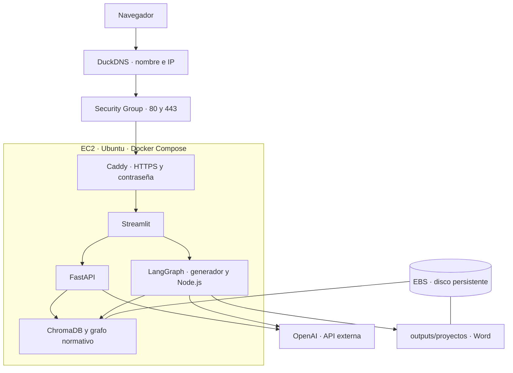

# Despliegue del piloto en AWS EC2

Guía desde una cuenta AWS hasta la aplicación privada o pública con HTTPS y
contraseña. Los comandos distinguen **PowerShell local (Windows)** de
**Ubuntu remoto (EC2)**. No ejecutes comandos PowerShell en Ubuntu ni al revés.

## 1. Arquitectura y alcance



- Una EC2 `t3.medium` (2 vCPU, 4 GiB RAM), Ubuntu Server 24.04 LTS x86-64,
  en Irlanda (`eu-west-1`), modalidad On-Demand.
- Un disco raíz EBS gp3 de 30 GiB cifrado, 3000 IOPS y 125 MiB/s.
- `compose.ec2.yml` define backend y frontend. Ambos usan `Dockerfile.frontend`
  para disponer de Python, Node.js y el paquete `docx`.
- `compose.public.yml` añade Caddy: los dos archivos se combinan, no se ejecutan
  como dos proyectos independientes.
- ChromaDB es una librería con almacenamiento local, no otro contenedor.
- Backend sin puertos publicados. Streamlit publicado solo en `127.0.0.1:8501`.
  Caddy publica 80/443 y soporta la conexión WebSocket de Streamlit.

**Límites del piloto:** contraseña compartida en Caddy, sin usuarios de aplicación
ni aislamiento de expedientes. LangGraph utiliza `MemorySaver`: el estado en
revisión y los adjuntos que solo estén en memoria se pierden al reiniciar.
`outputs` conserva Word finales, no un historial completo de expedientes.
Usar datos de prueba. No hay alta disponibilidad ni copias automáticas configuradas.

## 2. Cuenta AWS y control de gasto

1. Proteger el usuario raíz con MFA y reservarlo para tareas de cuenta.
2. Crear en IAM un usuario con acceso a consola y MFA. Para el montaje inicial
   se utilizó un grupo administrativo con `AdministratorAccess` (permisos amplios).
   No necesita claves de API de AWS para seguir esta guía.
3. Iniciar sesión con ese usuario. Los recursos y costes pertenecen a la cuenta
   AWS, no al usuario. Los participantes de Streamlit no necesitan acceso AWS.
4. Configurar un presupuesto mensual con avisos por correo según las horas
   previstas. Los avisos no son un corte automático del gasto.
5. Seleccionar Irlanda en la consola EC2. IAM es global.

No hace falta crear una organización ni habilitar IAM Identity Center para esta
ruta. Comprobar la oferta/créditos de la cuenta: `t3.medium` no se debe considerar
gratuita por el aviso genérico de Free Tier.

## 3. Crear EC2

EC2 → Instances → Launch instances:

| Campo | Valor |
|---|---|
| Nombre | `homologaciones-piloto` |
| AMI | Ubuntu Server 24.04 LTS oficial de Canonical, x86-64 |
| Tipo | `t3.medium`, una instancia |
| Compra | On-Demand, sin Spot ni compromisos |
| Red | VPC predeterminada, subred pública, IP pública automática |
| Disco | 30 GiB gp3 cifrado, clave predeterminada `aws/ebs` |
| SSH | TCP 22, origen My IP (`TU_IP/32`) |

Crear una clave RSA `.pem`, descargarla y conservarla fuera del repositorio.
Mantener inicialmente cerrados 80/443. Nunca abrir 8000/8501 para este despliegue.
No añadir EFS, FSx ni otros discos. Los archivos quedan en el disco raíz EBS.

Si se selecciona CPU Unlimited, pueden existir cargos por excedentes de créditos.
Standard evita esos cargos pero puede reducir el rendimiento al agotarse los
créditos. Comprobar esta opción y la tarifa antes de lanzar.

Esperar a `Running` y a que pasen las comprobaciones de estado. Copiar la IPv4
pública. Con `Delete on termination: Yes`, terminar EC2 elimina el disco raíz;
detenerla no lo elimina.

## 4. Conectar por SSH

En **PowerShell local**, reemplaza ruta e IP:

```powershell
$clavePiloto = "C:\ruta-privada\homologaciones-piloto.pem"
ssh -i "$clavePiloto" ubuntu@IP_PUBLICA
```

En la primera conexión, verificar la huella del servidor antes de aceptarla.
Al ver `ubuntu@ip-...:~$`, estás en EC2.

Si SSH rechaza el `.pem` por permisos demasiado abiertos, en PowerShell:

```powershell
$usuarioActual = [System.Security.Principal.WindowsIdentity]::GetCurrent().Name
icacls.exe "$clavePiloto" /grant:r "${usuarioActual}:(R)"
icacls.exe "$clavePiloto" /inheritance:r
icacls.exe "$clavePiloto"
```

Si quedan entradas explícitas de otros usuarios o grupos, retira solo la entrada
que señala SSH con `icacls.exe "$clavePiloto" /remove "USUARIO_O_GRUPO"`.
No compartas el contenido de la clave.

## 5. Instalar Docker (Ubuntu remoto)

```bash
sudo apt update
sudo apt upgrade -y
sudo apt install -y ca-certificates curl
sudo install -m 0755 -d /etc/apt/keyrings
sudo curl -fsSL https://download.docker.com/linux/ubuntu/gpg -o /etc/apt/keyrings/docker.asc
sudo chmod a+r /etc/apt/keyrings/docker.asc
```

Añadir el repositorio oficial (copiar el bloque completo):

```bash
sudo tee /etc/apt/sources.list.d/docker.sources > /dev/null <<EOF
Types: deb
URIs: https://download.docker.com/linux/ubuntu
Suites: $(. /etc/os-release && echo "$VERSION_CODENAME")
Components: stable
Architectures: $(dpkg --print-architecture)
Signed-By: /etc/apt/keyrings/docker.asc
EOF
sudo apt update
sudo apt install -y docker-ce docker-ce-cli containerd.io docker-buildx-plugin docker-compose-plugin
sudo systemctl enable --now docker
sudo docker --version
sudo docker compose version
sudo docker run --rm hello-world
```

Debe aparecer `Hello from Docker!`. Si Ubuntu pide reiniciar, usa `sudo reboot`
y reconecta por SSH cuando vuelva a estar disponible.

## 6. Preparar y transferir el proyecto (PowerShell local)

Detener los procesos locales que utilizan ChromaDB. Mantener las mismas versiones
de ChromaDB y el mismo modelo de embeddings al copiar el índice a Linux.

```powershell
cd "C:\Users\aleja\Desktop\proyecto-homologaciones"
Test-Path ".\compose.ec2.yml"
Test-Path ".\scripts_index\chroma_db\chroma.sqlite3"
```

Ambos deben devolver `True`. La carpeta debe contener el índice actualizado y
completo, no solo `chroma.sqlite3`: también necesita sus subdirectorios vectoriales.

Crear el paquete con una lista explícita de entradas:

```powershell
tar -czf "$env:TEMP\homologaciones-deploy.tar.gz" --exclude=__pycache__ --exclude=users.caddy --exclude="*.pyc" --exclude="*.pem" --exclude="*.key" compose.ec2.yml compose.public.yml Dockerfile.frontend requirements.txt package.json package-lock.json .dockerignore .env.example backend frontend proyecto_tecnico scripts_graph/graph.json scripts_index/chroma_db json deploy
tar -tzf "$env:TEMP\homologaciones-deploy.tar.gz"
```

Revisar el listado antes de enviarlo. No incluye `.env`, PDF, entornos locales,
Word ni respaldos. `$env:TEMP` es la carpeta temporal de Windows; se puede ver
ejecutando `$env:TEMP`. No es una carpeta de AWS.

```powershell
scp -i "$clavePiloto" "$env:TEMP\homologaciones-deploy.tar.gz" ubuntu@IP_PUBLICA:/home/ubuntu/
```

En **Ubuntu remoto**:

```bash
mkdir -p ~/proyecto-homologaciones
tar -xzf ~/homologaciones-deploy.tar.gz -C ~/proyecto-homologaciones
cd ~/proyecto-homologaciones
ls -lh compose.ec2.yml scripts_graph/graph.json scripts_index/chroma_db/chroma.sqlite3
mkdir -p outputs
cp .env.example .env
chmod 600 .env
nano .env
```

Configurar la clave OpenAI, los modelos utilizados localmente y las trazas según
necesidad. El modelo de embeddings debe coincidir con el índice. Guardar con
Ctrl+O, Intro; salir con Ctrl+X. No mostrar `.env` en logs ni compartirlo.
El Compose configura `BACKEND_URL=http://backend:8000` para el frontend.

## 7. Arrancar y validar en privado (Ubuntu remoto)

```bash
sudo docker compose -f compose.ec2.yml config --quiet
sudo docker compose -f compose.ec2.yml up -d --build
sudo docker compose -f compose.ec2.yml ps
sudo docker compose -f compose.ec2.yml exec frontend python -c "import requests; r=requests.get('http://backend:8000/health', timeout=10); print(r.status_code, r.text); r.raise_for_status()"
```

`build` construye imágenes; `up` arranca servicios; `-d` los deja en segundo plano;
`ps` consulta su estado. Esperar un 200 en `/health`. Un estado `Up` no valida
por sí solo ChromaDB ni las llamadas a IA.

En otra ventana de **PowerShell local**:

```powershell
ssh -i "$clavePiloto" -N -L 8501:127.0.0.1:8501 ubuntu@IP_PUBLICA
```

Si es una ventana nueva, vuelve a definir `$clavePiloto`. Mantener el túnel abierto
y visitar `http://localhost:8501`. Probar chatbot, fuentes, validación de CRs,
generación, reescritura, adjuntos y descarga Word.

El índice se abre desde disco: no ejecutar parsers ni reindexar en el arranque.

## 8. Publicar con DuckDNS y contraseña

### 8.1 DNS

En https://www.duckdns.org/ registrar un subdominio disponible. Por ejemplo,
`TU_NOMBRE.duckdns.org`; no usar literalmente este marcador. Introducir la IPv4
pública de EC2 y guardar. No utilizar la IP de tu ordenador ni compartir el token.

En **Ubuntu remoto**, añadir a `.env`:

```dotenv
PUBLIC_DOMAIN=TU_NOMBRE.duckdns.org
```

Sin protocolo ni ruta. Comprobar:

```bash
getent ahostsv4 TU_NOMBRE.duckdns.org
```

Debe resolver a EC2. No hay actualización automática de DuckDNS configurada:
si cambia la IP, hay que actualizarla manualmente.

### 8.2 Contraseña (Ubuntu remoto)

```bash
sudo docker run --rm -it caddy:2-alpine caddy hash-password
nano deploy/caddy/users.caddy
```

El primer comando pide una contraseña sin mostrar caracteres y devuelve un hash.
En `users.caddy` escribir una línea:

```text
piloto HASH_BCRYPT_COMPLETO
```

No poner la contraseña en claro. No poner el hash en `.env`: su archivo separado
evita problemas de interpolación con `$`. `users.caddy` está excluido de Git.
El navegador pedirá el usuario `piloto` y la contraseña original.

### 8.3 Cortafuegos

EC2 → instancia → Seguridad → Security Group asociado → editar reglas de entrada:

| Tipo | Puerto | Origen |
|---|---|---|
| SSH | TCP 22 | Tu IP pública /32 |
| HTTP | TCP 80 | `0.0.0.0/0` |
| HTTPS | TCP 443 | `0.0.0.0/0` |

No abrir 8000/8501. Revisar todos los grupos asociados: sus permisos se suman.
Si configuraste también un cortafuegos en Ubuntu, debe permitir estas conexiones.

### 8.4 Arranque público (Ubuntu remoto)

```bash
sudo docker compose -f compose.ec2.yml -f compose.public.yml config --quiet
sudo docker compose -f compose.ec2.yml -f compose.public.yml run --rm --no-deps caddy caddy validate --config /etc/caddy/Caddyfile --adapter caddyfile
sudo docker compose -f compose.ec2.yml -f compose.public.yml up -d --no-build
sudo docker compose -f compose.ec2.yml -f compose.public.yml ps
sudo docker compose -f compose.ec2.yml -f compose.public.yml logs --tail=100 caddy
```

`--no-build` reutiliza las imágenes ya construidas. Caddy obtiene y renueva los
certificados automáticamente y redirige HTTP a HTTPS. Necesita DNS correcto,
puertos accesibles y almacenamiento persistente; la validación de configuración
no comprueba por sí sola que el certificado pueda emitirse.

```bash
curl -I https://TU_NOMBRE.duckdns.org
```

Sin credenciales se espera **401 Unauthorized**, con certificado válido.
Abrir la URL en una ventana privada: debe pedir credenciales y luego mostrar
Streamlit. Probar desde móvil sin Wi-Fi. Compartir URL y credenciales por separado,
nunca el `.pem` ni la clave OpenAI. No se necesita túnel SSH para acceder por HTTPS.

## 9. Datos persistentes

En `/home/ubuntu/proyecto-homologaciones`:

| Datos | Persistencia |
|---|---|
| `scripts_index/chroma_db/` | Montaje del disco a ambos contenedores |
| `outputs/proyectos/` | Word finales, montaje del disco |
| `json/` y `scripts_graph/graph.json` | En el servidor y copiados en las imágenes al construir |
| `.env` | Configuración en el servidor, fuera de las imágenes |
| `deploy/caddy/` | Configuración y hash, montaje de solo lectura |
| Certificados Caddy | Volúmenes Docker `caddy_data` y `caddy_config` sobre EBS |
| Sesión y checkpoints en memoria | No persistentes; se pierden al reiniciar |

EBS es el disco raíz creado al lanzar EC2, no otro servicio de base de datos.
No usar `down -v`: eliminaría los volúmenes de certificados. No es necesario
reindexar al reconstruir contenedores o reiniciar EC2.

## 10. Parar y reanudar

Para una pausa, esperar a que acaben las generaciones y detener EC2 desde la
consola: Instance state → **Stop instance**. Cerrar navegador/SSH o parar Docker
no detiene la facturación del cómputo. EBS y copias conservadas siguen facturando.
No usar **Terminate** si quieres conservar la máquina y su disco.

Al volver:

1. Start instance; esperar comprobaciones de estado.
2. Consultar la nueva IPv4 pública y actualizar DuckDNS si cambió.
3. Actualizar la regla SSH si cambió la IP de tu ordenador.
4. Conectar por SSH y comprobar los tres servicios con ambos Compose.
5. Si faltan servicios, ejecutar `up -d --no-build` con ambos archivos.

`restart: unless-stopped` los reinicia tras el arranque del sistema, salvo que se
hubieran detenido manualmente. Usar siempre ambos Compose al operar el despliegue
público; el Compose base solo corresponde a la fase privada.

## 11. Actualizaciones y copias

- **Código:** transferir solo los archivos cambiados, preservando `.env`,
  `users.caddy`, índice y `outputs`. Ejecutar con ambos Compose `up -d --build`.
  Una reconstrucción puede interrumpir sesiones y perder revisiones en memoria.
- **No reenviar el paquete inicial sobre un servidor en uso:** contiene el índice
  local y podría sobrescribir datos. Para actualizar Chroma, detener los servicios,
  respaldar y sustituir la carpeta completa por una copia validada. Actualizar a
  la vez el grafo/JSON correspondientes y reconstruir las imágenes.
- **Variables `.env`:** volver a ejecutar `up -d` con ambos archivos para recrear
  los servicios afectados. Un simple `restart` no carga nuevas variables Docker.
- **Contraseña o Caddyfile:** editar el archivo en el servidor y ejecutar
  `sudo docker compose -f compose.ec2.yml -f compose.public.yml restart caddy`.
- **Copias:** detener los servicios con `stop` usando ambos Compose, crear un
  snapshot EBS y esperar a que se complete antes de reanudar con `up -d --no-build`.
  El snapshot contiene datos y secretos: restringir su acceso. Registrar también
  AMI, región, grupo de seguridad y configuración de acceso/DNS.
- Probar restauración en una instancia separada, aislada de acceso público, antes
  de confiar en la copia. Aplicar retención para evitar acumular snapshots.

## 12. Diagnóstico

Comandos en Ubuntu, desde la raíz del proyecto:

```bash
sudo docker compose -f compose.ec2.yml -f compose.public.yml ps
sudo docker compose -f compose.ec2.yml -f compose.public.yml logs --tail=100 backend frontend caddy
free -h
df -h
sudo docker system df
```

| Síntoma | Comprobar |
|---|---|
| SSH timeout | EC2 encendida, IP actual y regla SSH desde tu IP |
| `Permission denied (publickey)` | Usuario `ubuntu`, clave correcta y permisos del `.pem` |
| No existe `PUBLIC_DOMAIN` | `.env` en la raíz, nombre configurado y ambos Compose |
| Caddy no arranca | `users.caddy` existe, hash completo y sintaxis válida |
| Error de certificado/timeout web | DNS A correcto, sin AAAA incorrecto, 80/443 y logs Caddy |
| HTTP 401 | Esperable sin credenciales; si persiste, revisar usuario y contraseña |
| HTTP 502 | Frontend activo, red interna y logs de Streamlit |
| Fallo RAG | Carpeta Chroma completa, versiones/modelo coincidentes, clave y saldo API |
| No conecta con backend | `BACKEND_URL=http://backend:8000` y `/health` desde frontend |
| Word falla | Logs del generador, Node.js y montaje de `outputs` |
| Espacio insuficiente | Imágenes de compilación, logs y Word acumulados; revisar antes de borrar |

No publicar secretos de `.env` ni salidas que contengan datos personales.

## Referencias

- [Instalar Docker en Ubuntu](https://docs.docker.com/engine/install/ubuntu/)
- [HTTPS automático de Caddy](https://caddyserver.com/docs/automatic-https)
- [Contraseñas de Caddy](https://caddyserver.com/docs/caddyfile/directives/basic_auth)
- [Detener y arrancar EC2](https://docs.aws.amazon.com/AWSEC2/latest/UserGuide/Stop_Start.html)
